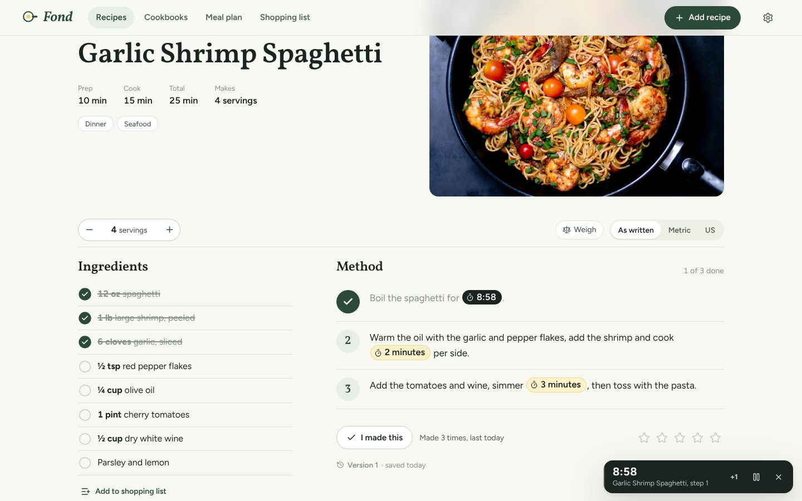
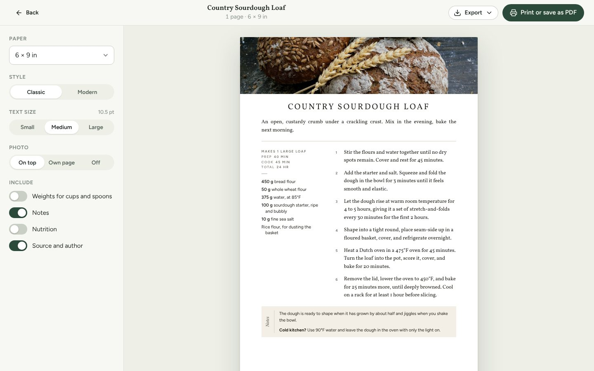
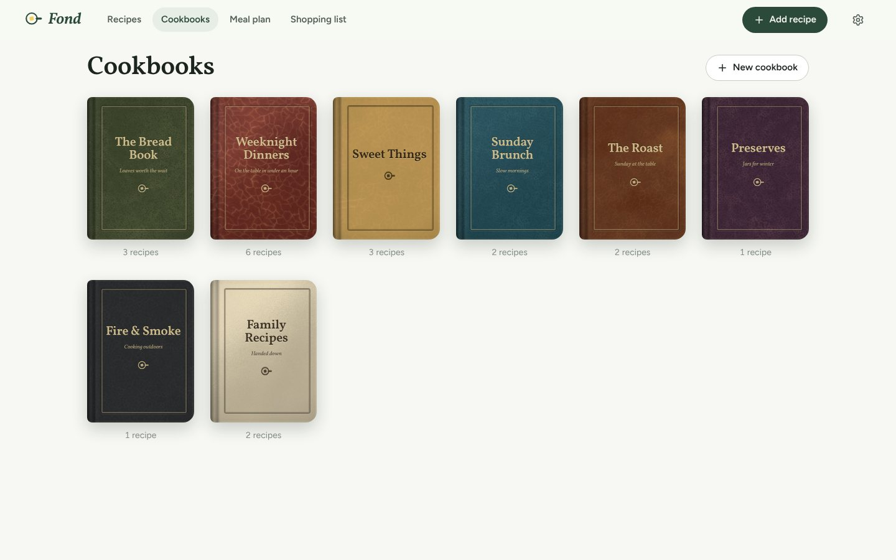
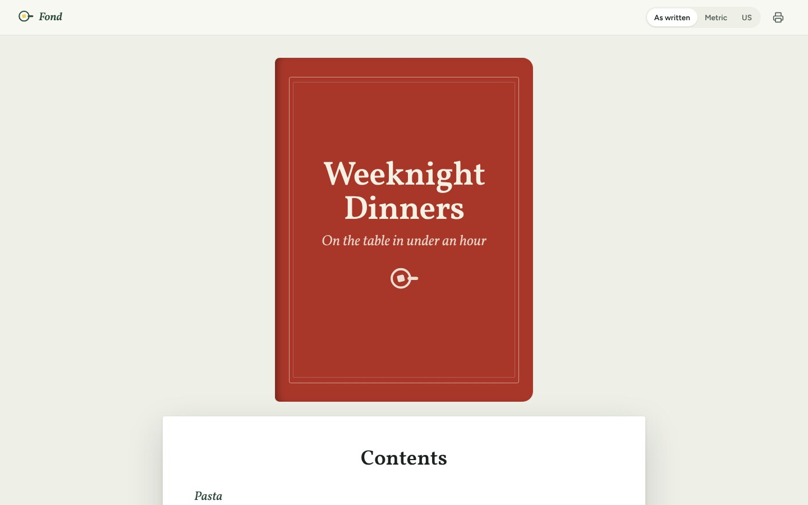
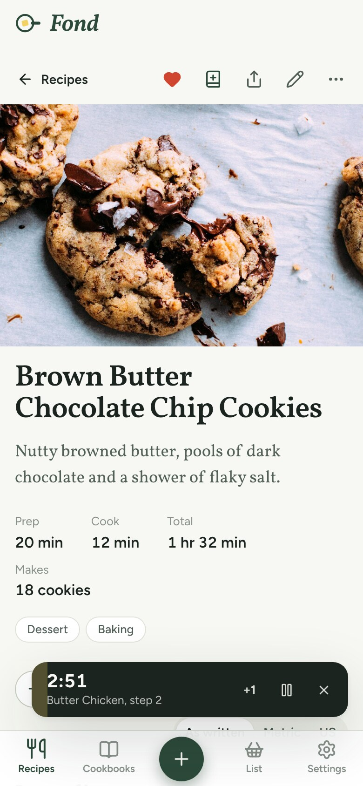
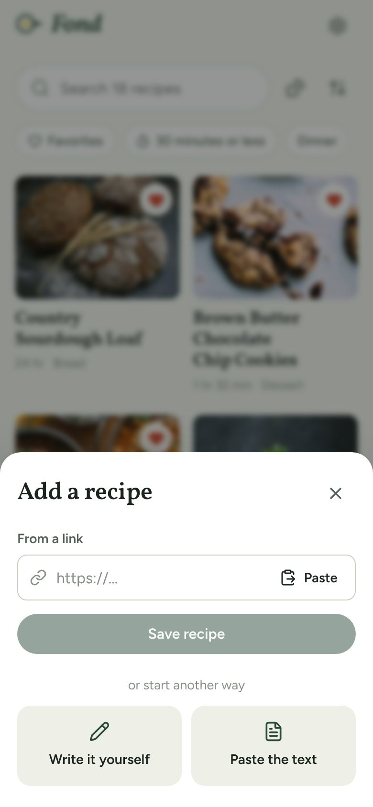

<p align="center"></p>
<h1 align="center">Fond</h1>
<p align="center">A fast, uncluttered, self-hosted recipe keeper.<br>One small container. One SQLite file. No food database to babysit.</p>


*Fond* is the browned, caramelized layer left in the pan: the part every good sauce is built on.

## Why Fond

- **Save a recipe from anywhere in one step.** Paste a link, share it from your phone, or press <kbd>Ctrl</kbd>/<kbd>⌘</kbd> <kbd>V</kbd> on the library page. Fond reads the page, keeps the photo, and links back to the original.
- **Ingredients are just text.** Type or paste `2 1/2 cups flour, sifted` and Fond understands it. Scaling, unit conversion and baker's percentages work without building a database of foods and units.
- **Made for cooking, not filing.** Tick off ingredients as you measure them and steps as you finish them. Times in a step become one-tap timers that complete the step when they ring. The screen stays awake while a recipe is open, and your place survives a reload.
- **Your units.** Show every recipe as written, in metric, or in US measures, and optionally by weight. When an author gives both (`1 cup (120 g)`), Fond uses the author's number instead of doing arithmetic.
- **Baker's percentages.** For any recipe with flour: percentages against total flour, hydration, and "make it with 800 g of flour" scaling. A sourdough starter is counted as half flour, half water.
- **Cookbooks.** Collect recipes into books with chapters. A recipe can live in as many books as you like.
- **Beautifully typeset.** Shared links, printouts and cookbooks are set in real book typography, in a classic, modern or compact style, on Letter, A4, half-letter or 4 × 6 cards, with an optional QR code back to the recipe.
- **Light.** A ~21 MB image, about 30 MB of RAM, and an 82 KB (gzipped) web app. No external database, cache or queue.
- **Safe to put on the internet.** See [Security](#security).

| Cooking | Typeset for print |
| --- | --- |
|  |  |
| **Cookbooks** | **A shared cookbook** |
|  |  |

<p align="center">
  
  
  
  
</p>

## Install

### Unraid

Add the template URL under **Docker → Add Container → Template repositories**, or download it into `/boot/config/plugins/dockerMan/templates-user/`:

```
https://raw.githubusercontent.com/au12/fond/main/unraid/fond.xml
```

The defaults (port `8080`, data in `/mnt/user/appdata/fond`, `PUID=99`, `PGID=100`) work as they are. Open the web UI and create the first account; it becomes the admin.

### Docker

```sh
docker run -d --name fond -p 8080:8080 -v ./data:/data \
  -e PUID=1000 -e PGID=1000 ghcr.io/au12/fond:latest
```

Or use the [`docker-compose.yml`](docker-compose.yml) in this repository. Images are published for `amd64` and `arm64`.

The container starts as root only long enough to make `/data` writable, then drops to `PUID:PGID`. To skip that step entirely, run it as the final user with a read-only root filesystem:

```sh
docker run -d --user 1000:1000 --read-only --cap-drop ALL \
  --security-opt no-new-privileges:true -p 8080:8080 -v ./data:/data ghcr.io/au12/fond:latest
```

### Behind a reverse proxy

Point the proxy at port `8080` and set `FOND_BASE_URL` to the public address so share links and link previews use it. With Nginx Proxy Manager no custom configuration is needed. Fond trusts `X-Forwarded-*` headers only from private-range addresses by default; narrow that with `FOND_TRUSTED_PROXIES` if you like. HTTPS is required for installing Fond as an app and for the Android share target.

## Save recipes from your phone

**Android.** Open Fond in Chrome and choose **Add to Home screen → Install**. Fond then appears in the share sheet of every app.

**iPhone and iPad.** Safari does not let web apps appear in the share sheet, so Fond uses a two-action Shortcut. **Settings → Save from your phone** creates a token and shows the exact values to paste; after that, "Save to Fond" sits in Safari's share sheet. Build it once and share the shortcut with the rest of the household.

**Desktop.** Drag the “Save to Fond” bookmark from the same settings page to your bookmarks bar, or just paste a link on the library page. The bookmark hands Fond the page your browser has already loaded, so it also works behind logins and on sites that refuse requests from servers.

## How importing works

Fond tries, in order: schema.org JSON-LD, schema.org microdata and RDFa, the markup of common recipe plugins, and finally "Ingredients" / "Instructions" headings (in several languages). Truncated structured data is detected and replaced by a richer list found further down the page.

Measured against the 1,149 saved real-world pages from 659 sites in the [recipe-scrapers](https://github.com/hhursev/recipe-scrapers) test corpus, with no AI and no per-site code:

| | |
| --- | --- |
| Ingredients and steps both extracted | **91.7 %** |
| Title correct | 97.8 % |
| Nothing found | 1.5 % |

Reproduce it with `FOND_CORPUS=/path/to/recipe-scrapers/tests/test_data go test ./internal/scrape -run Corpus -v`.

Some large sites turn away requests that come from servers. Fond does not pose as a search crawler to get around that. It tells you, and the bookmark (or an optional extra step in the iOS Shortcut) sends the page your own browser loaded instead.

**Optional AI assist.** Connect any OpenAI-compatible API (Ollama works) in **Settings → AI assist** and Fond will use it for the pages that have no recipe markup at all, for messy pasted text, and to read recipes from photos with a vision model. Nothing is sent anywhere unless you configure this.

## Moving from Mealie

**Settings → Import** (admin) takes any of:

- a **Mealie backup** zip (Mealie: *Settings → Backups*),
- a **recipe export** zip (Mealie: *Data Management*),
- the address and an API token of a **running Mealie server**.

Recipes, photos, categories, tags, tools, favorites, ratings and notes come across. Mealie's structured ingredients are turned back into plain lines exactly as Mealie displayed them, and Mealie cookbooks (which are saved filters) become real Fond cookbooks. Importing twice is safe: recipes already imported are skipped. For multi-gigabyte backups, drop the zip into the `import` folder inside Fond's data folder instead of uploading through your proxy.

The importer is tested against the backup fixtures in Mealie's own repository (nine schema versions, 1,021 recipes).

## Configuration

Everything is optional.

| Variable | Default | Purpose |
| --- | --- | --- |
| `PORT` | `8080` | Port to listen on |
| `PUID` / `PGID` | `99` / `100` | User and group that own `/data` |
| `TZ` | `UTC` | Time zone |
| `FOND_BASE_URL` | | Public address, e.g. `https://recipes.example.com` |
| `FOND_TRUSTED_PROXIES` | private ranges | IPs or CIDRs allowed to set `X-Forwarded-*` |
| `FOND_SECURE_COOKIES` | `auto` | `auto` marks cookies Secure over HTTPS; or `always` / `never` |
| `FOND_HSTS` | `false` | Send `Strict-Transport-Security` |
| `FOND_SESSION_DAYS` | `90` | How long a device stays signed in (sliding) |
| `FOND_ALLOW_PRIVATE_IMPORT` | `false` | Allow importing recipe links that point at your LAN |
| `FOND_AI_BASE_URL`, `FOND_AI_MODEL`, `FOND_AI_API_KEY` | | AI assist defaults (can also be set in the app) |
| `FOND_DATA` | `/data` | Data folder |

Locked out? `docker exec fond /fond reset-password <username>` prints a new password.

## Security

Fond is built to be reachable from the internet behind a reverse proxy.

- Passwords are hashed with argon2id. Sessions are random 256-bit tokens, stored hashed, in `HttpOnly`, `SameSite=Lax` cookies that are `Secure` over HTTPS.
- Login is rate limited per address and per account, with identical timing for unknown users.
- State-changing requests are checked for cross-origin use (CSRF); API tokens are separate, revocable, and shown once.
- A strict Content Security Policy with no inline scripts and no third-party requests, plus `frame-ancestors 'none'`, `nosniff` and a locked-down Permissions-Policy. Fonts and icons are self-hosted.
- Recipe links are fetched with a guard against server-side request forgery: private, loopback, link-local and metadata addresses are refused at connect time, including after redirects and DNS rebinding.
- Every photo is fully re-encoded, which strips location and camera metadata.
- Public sharing is off until you switch it on per recipe or cookbook, uses unguessable links, and is marked `noindex`.
- The image is `FROM scratch`: one static binary, no shell, no package manager, running as an unprivileged user.

Found a problem? Please open an issue, or a private security advisory for anything sensitive.

## Backups

Everything lives in the data folder: `fond.db` and `images/`. Back up that folder. **Settings → Import → Download everything** also gives you a portable zip of every recipe as JSON plus the photos.

## Development

```sh
cd web && npm install && npm run build && cd ..   # build the client into web/dist
FOND_DATA=./data go run ./cmd/fond                 # http://localhost:8080
```

Releases are cut by changing the number in `VERSION`; the workflow then publishes the versioned image and creates the GitHub release.

For live reload, run `npm run dev` in `web/` (it proxies the API to port 8080). `go test ./...` and `npm test` run the server and parser tests. `scripts/seed_demo.py` fills a fresh instance with the demo recipes used in the screenshots.

The server is Go with SQLite (pure Go, FTS5 for search). The client is Svelte 5. Typefaces are Vollkorn and Figtree, icons are Lucide, all under open licenses. Demo photos in the screenshots are from Unsplash.

## License

[MIT](LICENSE)
