<p align="center"></p>
<h1 align="center">Fond</h1>
<p align="center">A fast, uncluttered, self-hosted recipe keeper.<br>Save, cook, plan the week, shop, and keep your recipes in cookbooks that read like books.<br>One small container. One SQLite file. No food database to babysit.</p>

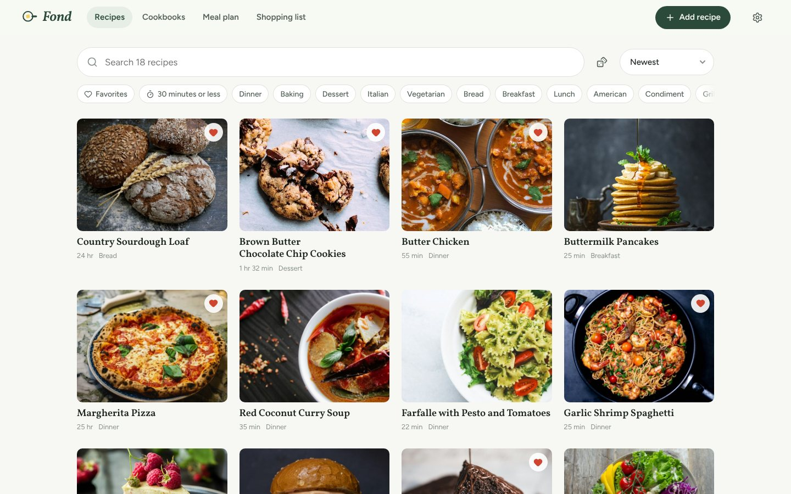

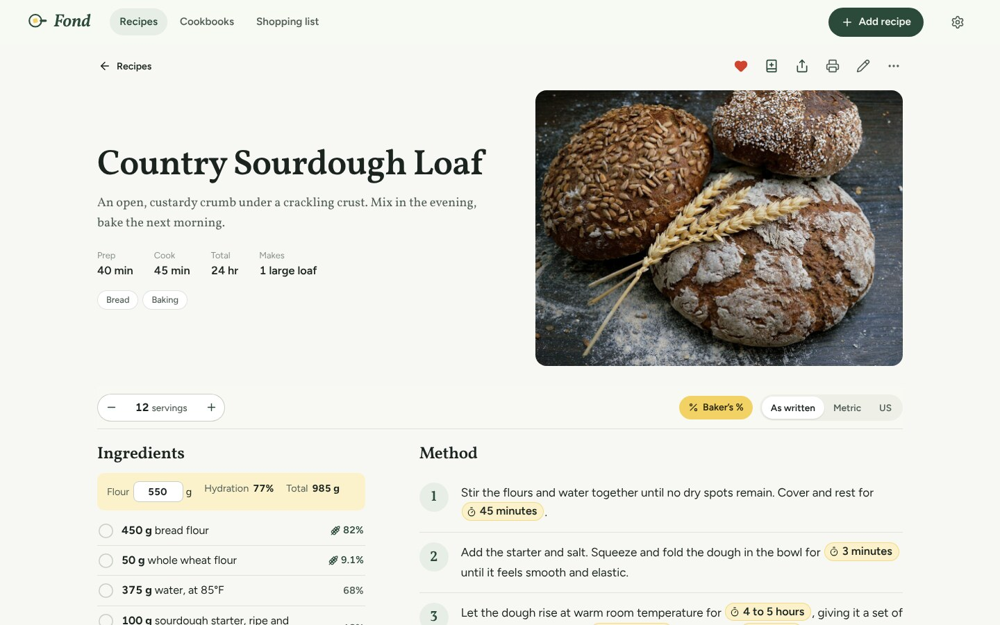

*Fond* is the browned, caramelized layer left in the pan: the part every good sauce is built on.

## Why Fond

- **Save a recipe from anywhere in one step.** Paste a link, share it from your phone, or press <kbd>Ctrl</kbd>/<kbd>⌘</kbd> <kbd>V</kbd> on the library page. Fond reads the page, keeps the photo, and links back to the original.
- **Ingredients are just text.** Type or paste `2 1/2 cups flour, sifted` and Fond understands it. Scaling, unit conversion, weights and baker's percentages work without building a database of foods and units.
- **Weigh instead of scooping.** One tap turns cups and spoons into grams, from a built-in table of about 250 foods drawn from USDA and Australian laboratory data and cross-checked against King Arthur's and America's Test Kitchen's charts. Estimates are marked ≈, anything Fond cannot place is left as written and marked **?**, and one more tap teaches it for every recipe. See [Weighing](#weighing).
- **Made for cooking, not filing.** Tick off ingredients as you measure them and steps as you finish them. Times in a step become one-tap timers that complete the step when they ring. The screen stays awake while a recipe is open, and your place survives a reload.
- **Your units.** Show every recipe as written, in metric, or in US measures. When an author gives both (`1 cup (120 g)`), Fond uses the author's number instead of doing arithmetic.
- **Baker's percentages.** For any recipe with flour: percentages against total flour, hydration, salt, and "make it with 800 g of flour" scaling. A starter is split into flour and water at the hydration you keep it at.
- **Every version kept.** Change the ingredients or the method and the recipe as it was is kept. The history shows what changed, line by line, and brings any version back.
- **Plan the week.** Put recipes, or notes like “Leftovers”, on the days and meals of the week, for as many servings as you are cooking. Drag a meal to another day on a desktop. One button puts the week's ingredients on the shopping list, scaled to the servings planned.
- **A shopping list that adds itself up.** The same ingredient from different recipes becomes one line: a cup of flour and 200 g of flour are 320 g of flour, two recipes' eggs are counted together, and cups and spoons stay exact. Lines are sorted into aisles. Merge any lines by hand, keep them apart, delete them one at a time or several at once.
- **Nutrition, worked out.** Calories, protein, fat, carbohydrate, fibre, sugars and sodium per serving, estimated from the ingredients with USDA FoodData Central figures, with a plain note of what was counted. Turn it off in Settings if you would rather not see it.
- **Cookbooks that read like books.** Collect recipes into books with chapters; a recipe can live in as many books as you like. Open one and it reads like a real cookbook: the leather cover opens, pages turn on the spine, the contents page jumps to a recipe, and every photograph faces its recipe. Two pages at a time on a wide screen, one at a time with a swipe on a phone. Every book is bound in a leather of its own, drawn from a random seed when the book is made, so no two covers match.
- **Printed beautifully, at any size.** A printed recipe or cookbook is laid out as real pages at the size of the paper, and the preview shows exactly those pages. Letter, A4, legal, half letter and A5; 6 × 9, 7 × 10 and 8 × 10 book pages; 5 × 7, 4 × 6 and 3 × 5 cards. Classic or modern, three text sizes, the photo on top, on its own page or left out, with notes, weights, nutrition, the source and a QR code back to the recipe. A whole cookbook prints as its book, with covers, contents and mirrored margins for printing on both sides. Recipes also export as Markdown, plain text or schema.org JSON.
- **Move in from anywhere.** Import from Mealie (backup, export or a running server), Tandoor, Paprika and Recipe Sage. Fond's own backups restore with one upload, into an empty Fond or merged into one you already use.
- **Light.** A ~21 MB image, about 30 MB of RAM, and a 152 KB (gzipped) web app, plus 26 KB for the ingredient table. No external database, cache or queue.
- **Safe to put on the internet.** Two-step sign-in with an authenticator app, and more. See [Security](#security).

| Cooking | Nutrition |
| --- | --- |
|  | 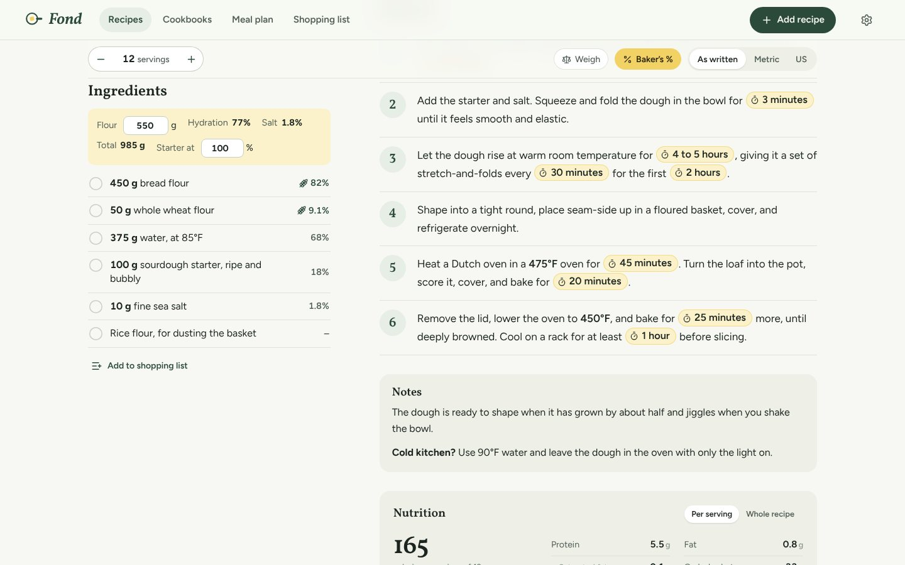 |
| **The week's plan** | **A shopping list that adds up** |
| 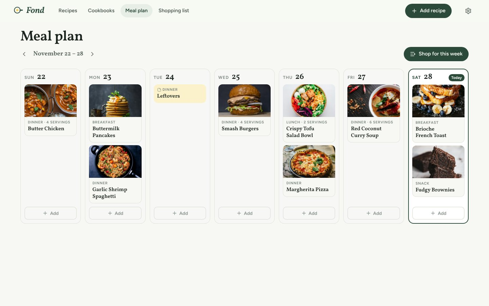 | 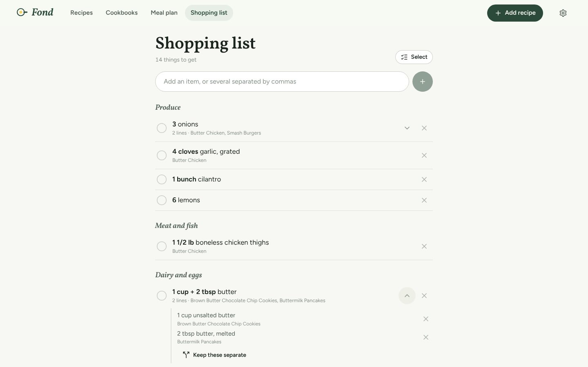 |
| **Cookbooks** | **Reading a cookbook** |
|  | 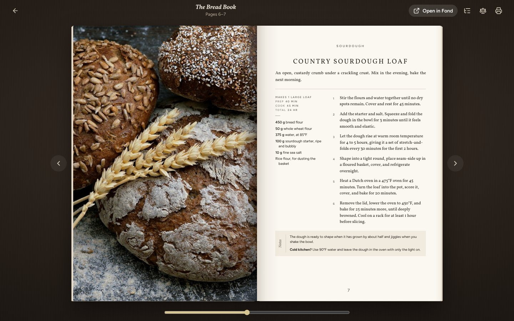 |
| **A cover that opens** | **A cookbook shared by link** |
| 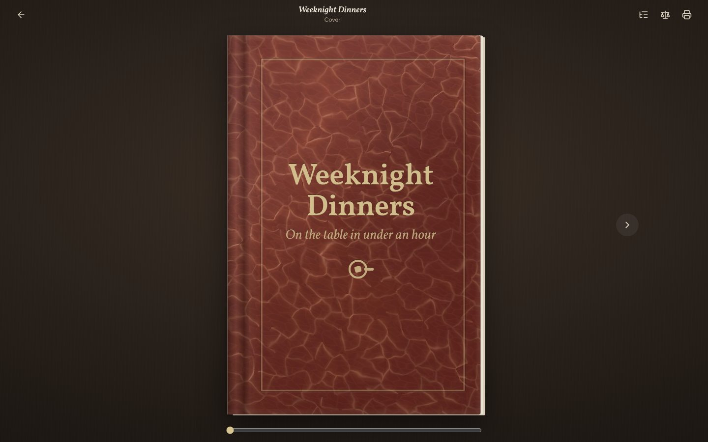 |  |
| **Printing a recipe** | **Printing a cookbook** |
|  | 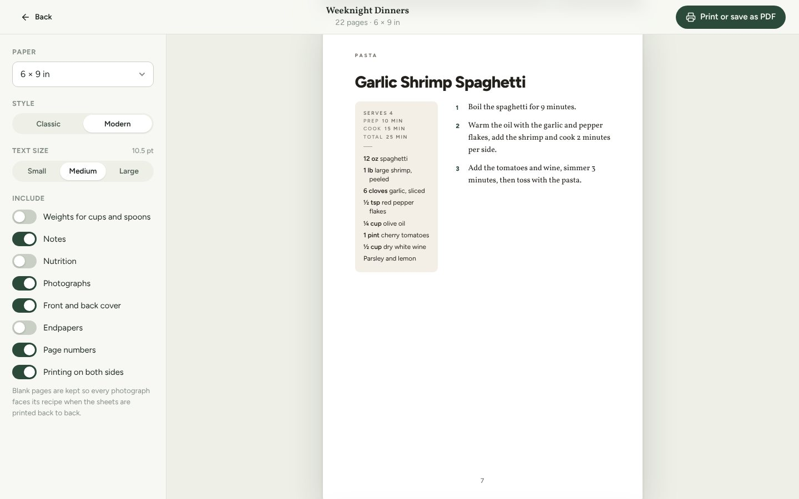 |

| **Weighing** | **Where each weight comes from** |
| --- | --- |
| 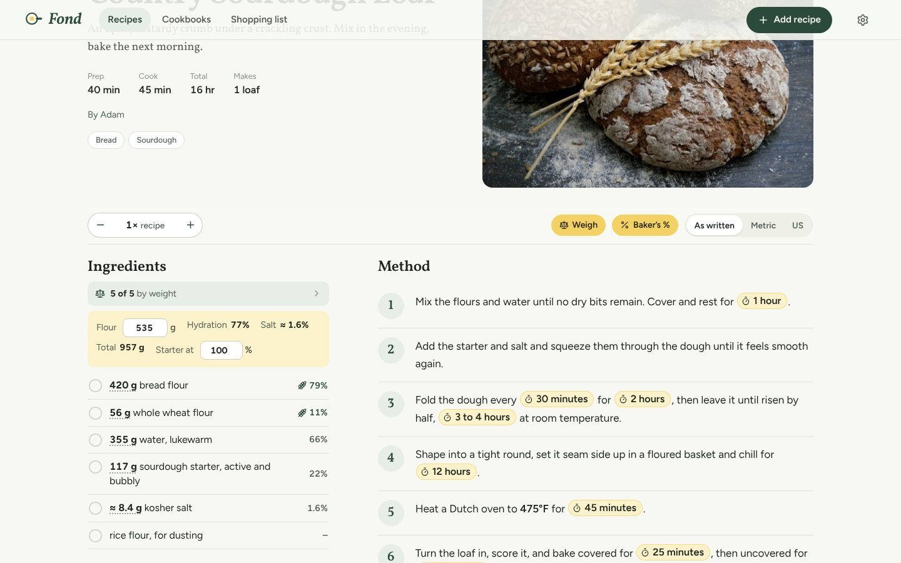 | 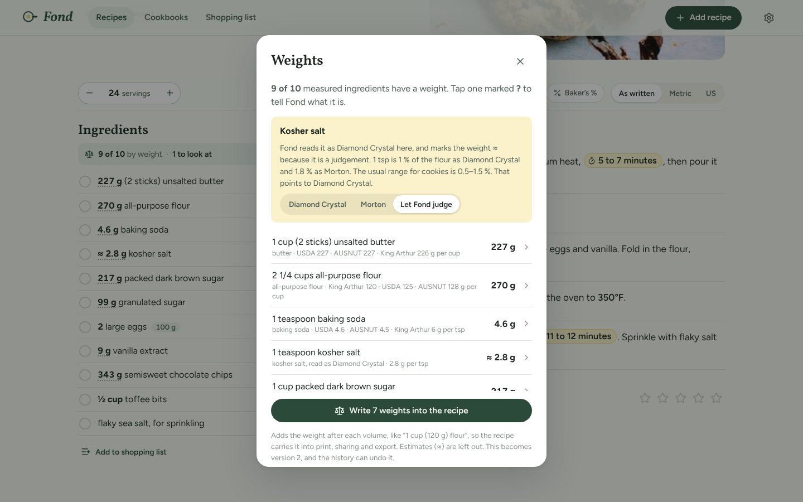 |

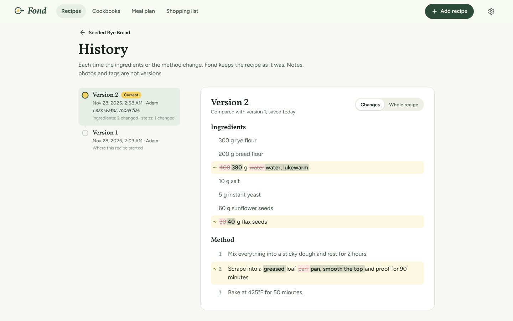

<p align="center">
  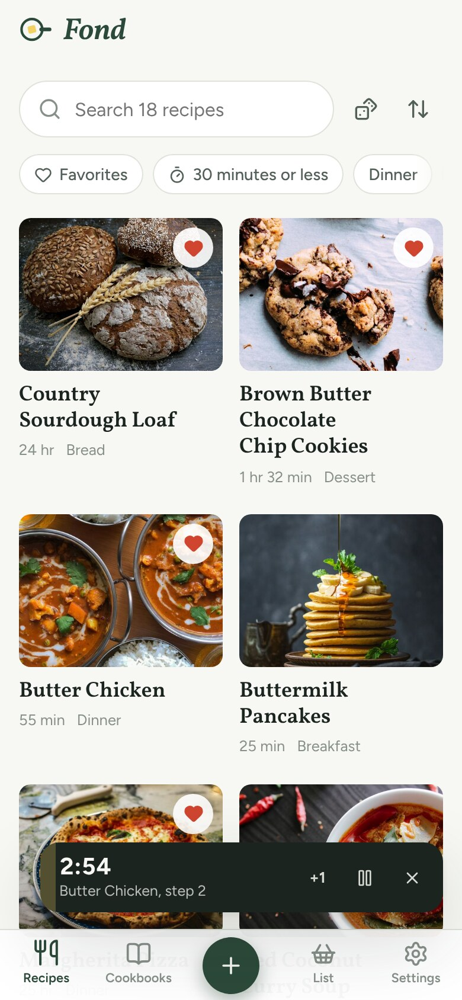
  
  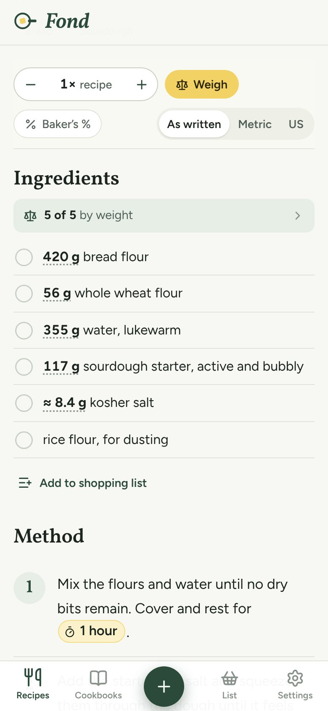
  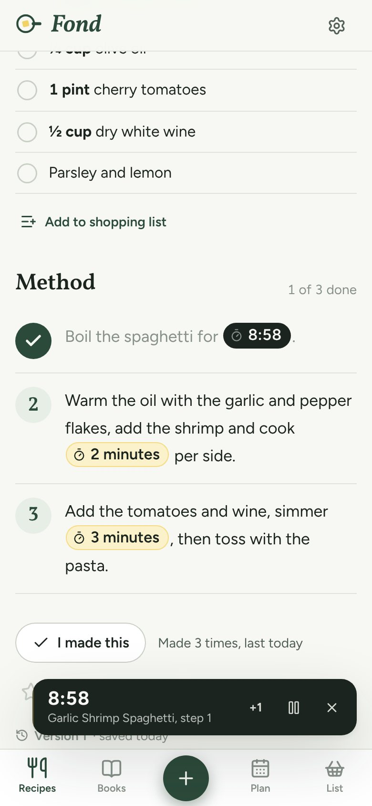
  
</p>
<p align="center">
  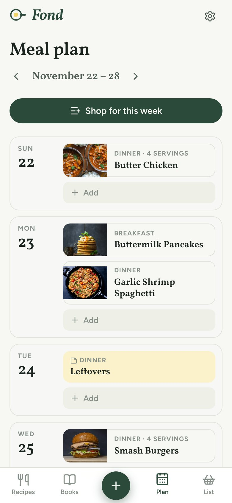
  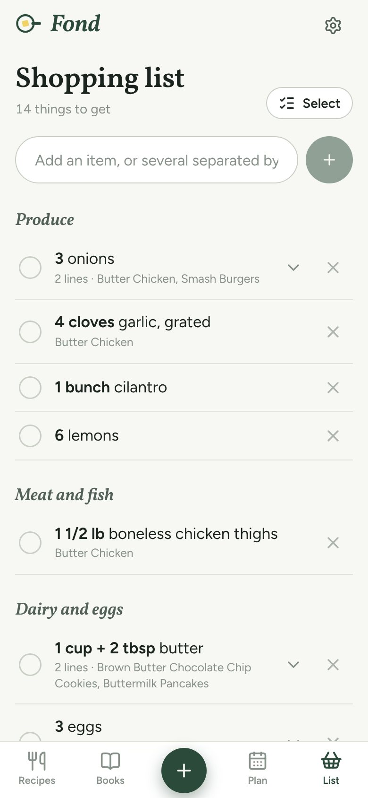
  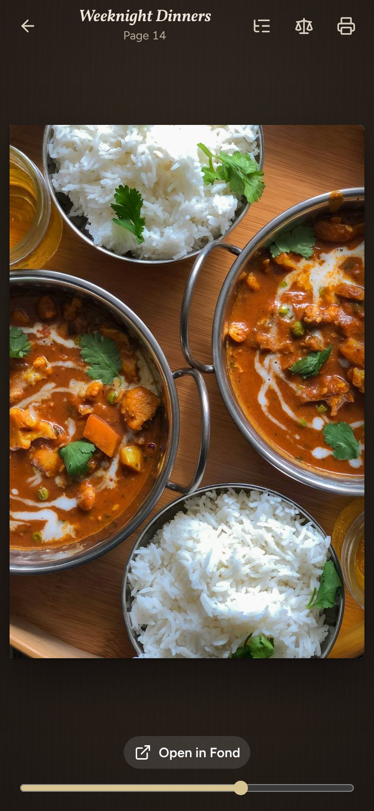
  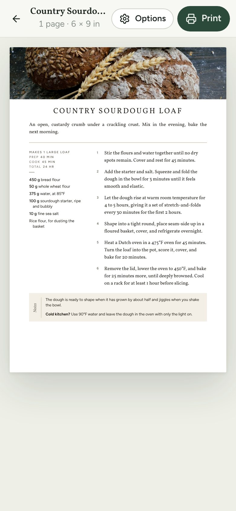
  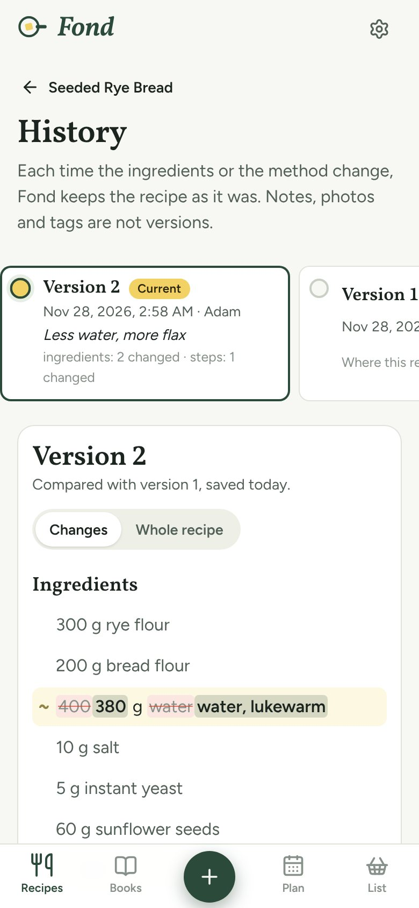
</p>

## Fond, Mealie and Tandoor

Mealie and Tandoor are good, mature projects, and both do things Fond does not. Fond exists for people who want less of an application and more of a cookbook. Checked against the source of Mealie 3.31 and Tandoor 2.6 in November 2026.

| | Fond | Mealie | Tandoor |
| --- | --- | --- | --- |
| What you run | One container, one SQLite file | One container (SQLite) or app + PostgreSQL | App + PostgreSQL in the official setup |
| Memory | About 30 MB measured | Docs suggest a 1000 MB container limit | No figure published |
| Ingredients | Plain text, parsed on the fly | Foods and units kept in a database | Foods and units kept in a database |
| Scaling and unit conversion | Yes, with no setup | Yes, once ingredients are parsed and linked | Yes, with unit conversions you define |
| Baker's percentages and hydration | **Yes** | No | No |
| Step timers | **Yes**, and they complete the step | No | Yes |
| Tick off ingredients and steps | **Yes**, and it survives a reload | Yes | Yes |
| Screen stays awake | Yes | Yes | Yes |
| Cookbooks | Hand-arranged, with chapters; a recipe can be in many | Saved filters over categories and tags | Hand-arranged books |
| Typeset print and share pages | **Real pages at 11 paper and card sizes, QR code** | Print view | Print view |
| Read a cookbook like a book | **Yes**: page turns, contents, facing photographs | No | No |
| Share a whole cookbook by link | **Yes**, per cookbook | Only by making the group public | With other accounts |
| Android share sheet | Yes | No | Yes |
| iPhone share sheet | Shortcut | Shortcut | Shortcut |
| Sites that block servers | Browser bookmark sends the loaded page | Paste the page's HTML by hand | Bookmarklet |
| Imports from Mealie | **Yes**: backup, export or live API | n/a | Yes |
| Meal planner | Yes | Yes | Yes |
| Shopping list joins the same ingredient | Yes, with no setup | Yes, for linked foods | Yes, for linked foods |
| Single sign-on (OIDC) | No | **Yes** | **Yes** |
| Two-step sign-in | **Authenticator codes, built in** | Through your single sign-on provider | Through your single sign-on provider |
| Nutrition | Estimated per serving from USDA data, with no setup | **Yes**, per food you fill in | **Yes**, per food and property |
| Importers from other apps | Mealie, Tandoor, Paprika, Recipe Sage | **Many** | **Many** |

Pick Mealie or Tandoor if you want single sign-on, many importers or nutrition tracked food by food. Pick Fond if you want to save recipes quickly, cook from them comfortably, plan the week without a database of foods to keep, and keep cookbooks that look and print like books.

## Install

### Unraid

Add the template URL under **Docker → Add Container → Template repositories**, or download it into `/boot/config/plugins/dockerMan/templates-user/`:

```
https://raw.githubusercontent.com/au12/fond/main/unraid/fond.xml
```

The defaults (port `8080`, data in `/mnt/user/appdata/fond`, `PUID=99`, `PGID=100`) work as they are. Open the web UI and create the first account; it becomes the admin.

### Docker

```sh
docker run -d --name fond -p 8080:8080 -v ./data:/data \
  -e PUID=1000 -e PGID=1000 ghcr.io/au12/fond:latest
```

Or use the [`docker-compose.yml`](docker-compose.yml) in this repository. Images are published for `amd64` and `arm64`.

The container starts as root only long enough to make `/data` writable, then drops to `PUID:PGID`. To skip that step entirely, run it as the final user with a read-only root filesystem:

```sh
docker run -d --user 1000:1000 --read-only --cap-drop ALL \
  --security-opt no-new-privileges:true -p 8080:8080 -v ./data:/data ghcr.io/au12/fond:latest
```

### Behind a reverse proxy

Point the proxy at port `8080` and set `FOND_BASE_URL` to the public address so share links and link previews use it. With Nginx Proxy Manager no custom configuration is needed. Fond trusts `X-Forwarded-*` headers only from private-range addresses by default; narrow that with `FOND_TRUSTED_PROXIES` if you like. HTTPS is required for installing Fond as an app and for the Android share target.

## Save recipes from your phone

**Android.** Open Fond in Chrome and choose **Add to Home screen → Install**. Fond then appears in the share sheet of every app.

**iPhone and iPad.** Safari does not let web apps appear in the share sheet, so Fond uses a two-action Shortcut. **Settings → Save from your phone** creates a token and shows the exact values to paste; after that, "Save to Fond" sits in Safari's share sheet. Build it once and share the shortcut with the rest of the household.

**Desktop.** Drag the “Save to Fond” bookmark from the same settings page to your bookmarks bar, or just paste a link on the library page. The bookmark hands Fond the page your browser has already loaded, so it also works behind logins and on sites that refuse requests from servers.

## Weighing

Turn on **Weigh** on a recipe (or make it the default in **Settings → Weighing**) and volumes become weights:

- `1 cup all-purpose flour` reads `120 g`; `1/4 teaspoon instant yeast` reads `0.77 g`. Counted things keep their count and gain a weight beside it: `3 large eggs · 150 g`.
- A weight the recipe already gives, `2 cups (250 g) flour`, always wins over arithmetic.
- An estimate is marked **≈**: the sources disagree by more than a tenth, or the amount depends on how something is cut or packed (fresh herbs, "1 onion").
- A line Fond cannot place stays exactly as written and gets a **?**. Tap it to pick the closest food, to weigh it once yourself, or to say it should be left alone, for every recipe in the household or only this one. The edit page shows each line's weight as you type and flags the same lines, and **Settings → Weighing** lists everything in your library that still has no weight, most used first.
- **Weights** shows every line with its figure and where it comes from, and can write the weights into the recipe (`1 cup (120 g) flour`) so they travel into print, sharing and export. That becomes a new version, so it can be undone.

Three things are matters of judgement, and Fond says so rather than hiding them:

- **A cup of flour** is 120 g, spooned and levelled, as King Arthur measures it. If you dip the cup into the bag, switch **Settings → Weighing** to 142 g. Recipes saved from King Arthur Baking and from America's Test Kitchen (with Cook's Illustrated and Cook's Country) are weighed the way those kitchens say they fill a cup, whichever you chose.
- **Kosher salt** is two different salts: a teaspoon of Diamond Crystal weighs 2.8 g and a teaspoon of Morton 4.8 g. When a recipe does not say which, Fond works it out from the amount: a loaf with 500 g of flour and a tablespoon of kosher salt is 1.7 % salt with Diamond Crystal and 2.9 % with Morton, and bread is made at about 2 %. It shows that reasoning, marks the weight ≈, and lets you overrule it. When the amount fits both, it says it cannot tell.
- **Fractions of a gram** need a scale that reads to 0.01 g. Fond mentions that once.

### Where the numbers come from

The table (`web/src/data/foods.json`, about 250 foods and 3,500 names) is built by [`scripts/foods`](scripts/foods) from USDA FoodData Central (SR Legacy and FNDDS) and the AUSNUT 2023 food measures, each food cross-checked across those sources and against the weight charts published by King Arthur Baking and America's Test Kitchen. [`scripts/foods/report.md`](scripts/foods/report.md) lists every food with what each source says.

Matching is deliberately cautious. A line is tied to a food by the head noun of its name, so "boiling water" is water, "butternut squash" is squash and "water, for the sugar syrup" is still water; "dried", "cooked", "powdered" and the name of a second food stop a match rather than risk a wrong one. On 11,000 ingredient lines from recipe sites it weighs 97.5 % of cup measures and 98.3 % of spoon measures, and a golden set of 529 lines in the test suite pins the answers.

USDA data is in the public domain. AUSNUT 2023 is © Food Standards Australia New Zealand, used under [CC BY 4.0](https://creativecommons.org/licenses/by/4.0/).

## Meal plan and shopping list

**Plan** shows a week at a time, starting on the day your week starts. Add a recipe or a note to any day, as breakfast, lunch, dinner or a snack, for a number of servings; on a recipe, the calendar button puts it straight on the plan. **Shop for this week** adds the ingredients of the meals you pick, scaled to the servings planned, leaving out the days already past.

The shopping list keeps each line as written and works out the rest when it is shown. Lines Fond can tie to the same food in its ingredient table are joined and added up: weights add to a weight, cups and spoons to an exact measure (`1 cup + 2 tbsp`), counts to a count, and different kinds of measure of a food it can weigh to one weight. Lines it can't join are kept as they are, so nothing is lost. Each joined line shows which recipes it came from and opens to the lines inside it. **Select** picks lines to merge by hand or delete together; a joined line can be kept apart again.

## Nutrition

Every food in the ingredient table carries USDA FoodData Central (SR Legacy, FNDDS) figures per 100 g. Fond weighs each ingredient line the way it does for **Weigh**, adds the lines up, and divides by the servings. The panel at the foot of a recipe says how many ingredients were counted and what share of the recipe by weight that covers, and lists any it could not count. Lines without an amount ("salt to taste"), fat for frying and flour for dusting are left out. Figures are for the raw ingredients, so treat them as a guide. **Settings → Preferences → Nutrition** turns the panel off; a recipe's own figures from its source are shown beside the estimate.

## Printing

Printing lays a recipe or a cookbook out as real pages at the size of the paper, and the preview is those pages, so what you see is what prints. Type is set for the sheet: 11 pt on a letter page at the medium size, smaller on a card. A recipe takes the fewest pages it can at a comfortable size: the layout is tightened a little at a time, and only when it still won't fit does the method continue on another page, never below a readable size. Use **Print or save as PDF**; every browser can save the result as a PDF. Your choices are remembered for next time.

## Recipe history

Every recipe has a version number, shown at the foot of the page. A save that changes the ingredients or the method starts a new version and keeps the old one; edits to the title, notes, tags or photo do not. **History** lists each version with who saved it, when, and the note they left, shows what changed down to the word, and restores any version as a new one, so nothing is ever overwritten. The first version and the latest hundred are kept.

## How importing works

Fond tries, in order: schema.org JSON-LD, schema.org microdata and RDFa, the markup of common recipe plugins, and finally "Ingredients" / "Instructions" headings (in several languages). Truncated structured data is detected and replaced by a richer list found further down the page.

Measured against the 1,149 saved real-world pages from 659 sites in the [recipe-scrapers](https://github.com/hhursev/recipe-scrapers) test corpus, with no AI and no per-site code:

| | |
| --- | --- |
| Ingredients and steps both extracted | **91.7 %** |
| Title correct | 97.8 % |
| Nothing found | 1.5 % |

Reproduce it with `FOND_CORPUS=/path/to/recipe-scrapers/tests/test_data go test ./internal/scrape -run Corpus -v`.

Some large sites turn away requests that come from servers. Fond does not pose as a search crawler to get around that. It tells you, and the bookmark (or an optional extra step in the iOS Shortcut) sends the page your own browser loaded instead.

**Optional AI assist.** Connect any OpenAI-compatible API (Ollama works) in **Settings → AI assist** and Fond will use it for the pages that have no recipe markup at all, for messy pasted text, and to read recipes from photos with a vision model. With it on, Fond can also ask the model which known food an unfamiliar ingredient weighs like; it only ever suggests, and you confirm. Nothing is sent anywhere unless you configure this.

## Moving from another app

**Settings → Import** (admin) takes an export from any of these and works out which app made it:

- **Mealie**: a backup zip (*Settings → Backups*), a recipe export zip (*Data Management*), or the address and an API token of a running Mealie server.
- **Tandoor**: the zip from *Import/Export → Export* in the Default format.
- **Paprika**: a `.paprikarecipes` file (*File → Export → Paprika Recipe Format*), or a single `.paprikarecipe`.
- **Recipe Sage**: the JSON-LD export (*Settings → Export your data*). Photos are fetched from the links in the export.

From Mealie, recipes, photos, categories, tags, tools, favorites, ratings and notes come across. Mealie's structured ingredients are turned back into plain lines exactly as Mealie displayed them, and Mealie cookbooks (which are saved filters) become real Fond cookbooks. Importing twice is safe: recipes already imported are skipped. For multi-gigabyte backups, drop the zip into the `import` folder inside Fond's data folder instead of uploading through your proxy.

The Mealie importer is tested against the backup fixtures in Mealie's own repository (nine schema versions, 1,021 recipes). Tandoor's named steps become headings in both lists, Paprika's photos and ratings come across, and Recipe Sage's notes and labels do too.

## Configuration

Everything is optional.

| Variable | Default | Purpose |
| --- | --- | --- |
| `PORT` | `8080` | Port to listen on |
| `PUID` / `PGID` | `99` / `100` | User and group that own `/data` |
| `TZ` | `UTC` | Time zone |
| `FOND_BASE_URL` | | Public address, e.g. `https://recipes.example.com` |
| `FOND_TRUSTED_PROXIES` | private ranges | IPs or CIDRs allowed to set `X-Forwarded-*` |
| `FOND_SECURE_COOKIES` | `auto` | `auto` marks cookies Secure over HTTPS; or `always` / `never` |
| `FOND_HSTS` | `false` | Send `Strict-Transport-Security` |
| `FOND_SESSION_DAYS` | `90` | How long a device stays signed in (sliding) |
| `FOND_ALLOW_PRIVATE_IMPORT` | `false` | Allow importing recipe links that point at your LAN |
| `FOND_AI_BASE_URL`, `FOND_AI_MODEL`, `FOND_AI_API_KEY` | | AI assist defaults (can also be set in the app) |
| `FOND_DATA` | `/data` | Data folder |

Locked out? `docker exec fond /fond reset-password <username>` prints a new password, and `docker exec fond /fond reset-2fa <username>` turns off two-step sign-in for someone who has lost their phone and their recovery codes.

## Security

Fond is built to be reachable from the internet behind a reverse proxy.

- Passwords are hashed with argon2id. Sessions are random 256-bit tokens, stored hashed, in `HttpOnly`, `SameSite=Lax` cookies that are `Secure` over HTTPS.
- Login is rate limited per address and per account, with identical timing for unknown users.
- Two-step sign-in: each person can turn on authenticator codes (RFC 6238) in **Settings → Account**, with ten single-use recovery codes. A code works once; the password step waits five minutes and five tries for its code. An admin can turn it off for someone in **Settings → Household**.
- State-changing requests are checked for cross-origin use (CSRF); API tokens are separate, revocable, and shown once.
- A strict Content Security Policy with no inline scripts and no third-party requests, plus `frame-ancestors 'none'`, `nosniff` and a locked-down Permissions-Policy. Fonts and icons are self-hosted.
- Recipe links are fetched with a guard against server-side request forgery: private, loopback, link-local and metadata addresses are refused at connect time, including after redirects and DNS rebinding.
- Every photo is fully re-encoded, which strips location and camera metadata.
- Public sharing is off until you switch it on per recipe or cookbook, uses unguessable links, and is marked `noindex`.
- The image is `FROM scratch`: one static binary, no shell, no package manager, running as an unprivileged user.

Found a problem? Please open an issue, or a private security advisory for anything sensitive.

## Backups

Everything lives in the data folder: `fond.db`, `images/` and `leather/` (the cookbook covers as drawn). Back up that folder. **Settings → Import → Download a backup** also gives you a portable zip: every recipe with its history and photo, the cookbooks and their covers, favourites, the household's weighing corrections, the meal plan and the shopping list.

To restore it, choose the zip under **Restore a backup** on the same page. **Add to this library** brings in what isn't there yet and skips copies, so it is also how two Fonds become one. **Replace everything** clears the library first and puts the backup back exactly as it was. Accounts are not part of the backup; copy the data folder to keep those too.

## Development

```sh
cd web && npm install && npm run build && cd ..   # build the client into web/dist
FOND_DATA=./data go run ./cmd/fond                 # http://localhost:8080
```

Releases are cut by changing the number in `VERSION`; the workflow then publishes the versioned image and creates the GitHub release.

For live reload, run `npm run dev` in `web/` (it proxies the API to port 8080). `go test ./...` and `npm test` run the server and parser tests. To change what an ingredient weighs, edit `scripts/foods/foods.txt` and run `python3 scripts/foods/build.py`; see [`scripts/foods/README.md`](scripts/foods/README.md). `scripts/seed_demo.py` fills a fresh instance with the demo recipes used in the screenshots.

Cookbook leather is drawn by `internal/leather`: a seed and a cover colour go in, a hide comes out, and the same seed always draws the same hide. To look at a spread of them while changing the drawing, `LEATHER_SHEET=/tmp/sheet.png go test ./internal/leather -run Sheet` writes a contact sheet (the test file lists the knobs). Hides already drawn are kept in `leather/` in the data folder, so a change to the drawing only shows on covers drawn afterwards.

The server is Go with SQLite (pure Go, FTS5 for search). The client is Svelte 5. Typefaces are Vollkorn and Figtree, icons are Lucide, all under open licenses. Demo photos in the screenshots are from Unsplash.

## License

[MIT](LICENSE)
